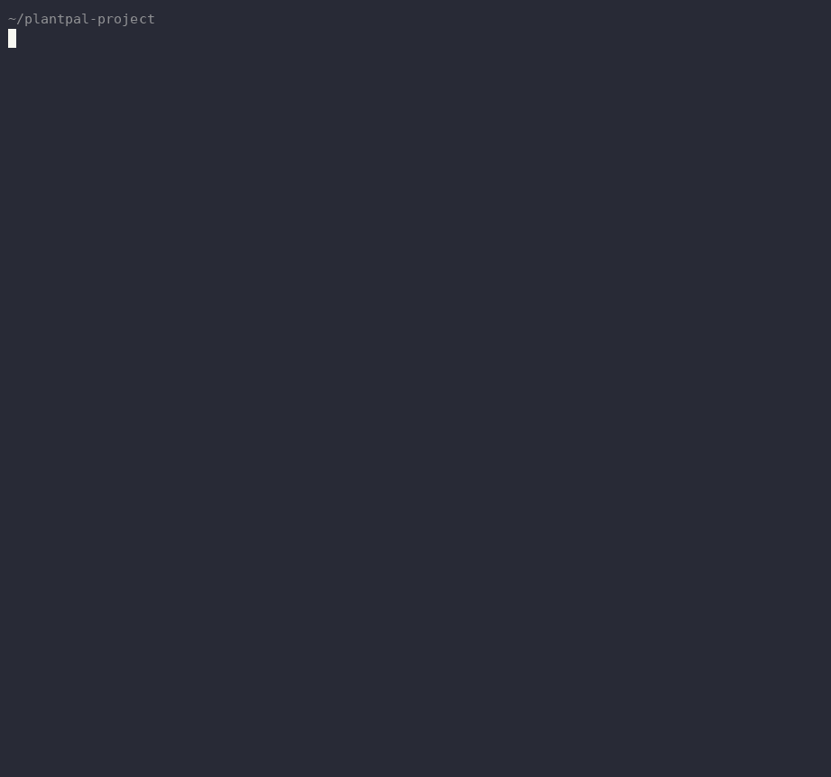

# OpenIdea

A Claude Code plugin that makes an app's definition clear **before** anyone builds it. Meeting notes and documents hide blind spots that usually surface mid-build; OpenIdea forces them out in the idea phase. It captures ideas, derives a concrete blueprint from them, finds the gaps (hidden assumptions, contradictions, missing details), proposes the cheapest way to validate each one, and shows everything in an HTML dashboard. People only validate and approve. Approved milestones become [OpenSpec](https://github.com/Fission-AI/OpenSpec) changes.

Everything stays file-based: markdown and JSON under `openidea/`, git-friendly and readable without any tool.



*A real run: `/openidea:init` → `/openidea:capture` → `/openidea:evaluate` (catches a real offline-first conflict and asks before proceeding) → `/openidea:plan`. Nothing staged — this is what the plugin actually outputs.*

## Install

```
/plugin marketplace add pimlabs/openidea
/plugin install openidea@pimlabs
```

## Quick Start

```
/openidea:init
  → describe the product in your own words → openidea/BRIEF.md

/openidea:capture
  → describe ideas, or paste meeting notes to extract several → openidea/ideas/<slug>.md

/openidea:blueprint
  → derives actors, entities, permissions, flows, screens, integrations, NFR
    from the ideas → openidea/blueprint/blueprint.json
  → every element is traced to its ideas; anything no idea states is flagged
    as a hidden assumption

/openidea:evaluate
  → hunts for blind spots (probe, coverage, consistency, domain)
  → writes each as openidea/gaps/<id>.md with a proposed validation
  → shows a decision queue of at most 5 gaps, recommends idea status

/openidea:resolve <gap-id>
  → record the answer or evidence, or an accepted risk; updates the ideas

/openidea:plan
  → arranges ready ideas into milestones with an explicit ID → openidea/ROADMAP.md

/openidea:estimate
  → phases per milestone and a timeline range, widened by what is still undefined,
    plus what each open gap costs in days; calibrates on recorded actuals

/openidea:prototype
  → openidea/prototype/index.html: click through every flow as every role;
    undefined behaviour shows in red, "Note a problem" turns into a gap

/openidea:dashboard
  → openidea/dashboard/index.html: one file, opens offline in any browser

/openidea:spec-draft <milestone>
  → requires an existing openspec/ folder and a clear gate
  → openspec/changes/<ID>/{proposal,design,tasks}.md + specs/<capability>/spec.md
```

If a client or an external team is involved, `/openidea:compile` (client-facing proposal narrative) and `/openidea:export` (technical handoff package) slot in between `plan` and `spec-draft`, `/openidea:dashboard client` produces a client-safe dashboard, and `/openidea:spec-audit` checks the OpenSpec output against the source ideas afterward.

## How blind spots are found

Blind spots are, by definition, not written in the notes, so reading them more carefully does not help. OpenIdea uses four mechanisms:

| Mechanism | What it catches |
|---|---|
| **Derivation probe** | Turning ideas into a concrete blueprint forces decisions. Anything the app needs that no idea states is a hidden assumption; any idea that produces nothing is too vague to build. |
| **Coverage** | Each idea checked against a checklist of what usually gets forgotten: roles and permissions, data lifecycle, empty and error states, failure modes, offline/scale, integrations, privacy, migration, success metric. Add your own domain checklists in `openidea/checklists/`. |
| **Consistency** | Ideas against each other, against the source notes, and against the brief's non-goals. Structural conflicts (like two ideas giving opposite permissions) are caught by code, not by re-reading. |
| **Domain** | Regulations and known pitfalls for the product's domain that nobody mentioned. |

Each gap carries a kind (decision, clarification, desirability, feasibility, compliance), and the kind decides the cheapest validation: a closed question to the owner, a question quoting both conflicting sources, a 5-interview script, a time-boxed spike, or a regulation check. An idea cannot become `ready` while a high-impact gap on it is open, unless someone records an accepted risk.

## Dashboard

`/openidea:dashboard` (or `openidea dashboard`) writes a single self-contained HTML file in five sections: Overview (health, the decision queue, milestone gates), Features (one page per flow with its activity diagram), Roadmap (phases, timeline range, what open gaps cost), Blueprint (context diagram, elements with state machines, permission matrix, missing details in red) and Ideas. It works on phones too.

**Diagrams** are generated from the blueprint by code, never drawn by a model: a system context diagram, an activity diagram per flow (undefined failure or empty-state branches show as red nodes), and a state machine per entity (unreachable states in red). They are Mermaid, so `openidea/blueprint/diagrams.md` renders directly on GitHub; the dashboard loads Mermaid from a CDN and shows the source text when offline. `--client` writes a separate `client.html` without source quotes, gap details, chores, or checks, safe to send outside.

## CLI

The deterministic part runs as a zero-dependency Node.js (18+) script bundled with the skill. Commands call it automatically; you can also run it yourself from your project root:

```
node <plugin>/skills/openidea/scripts/openidea.mjs validate      # exit 1 on any rule violation
node <plugin>/skills/openidea/scripts/openidea.mjs index         # regenerate ideas/INDEX.md
node <plugin>/skills/openidea/scripts/openidea.mjs diagrams      # feature list + Mermaid diagrams
node <plugin>/skills/openidea/scripts/openidea.mjs dashboard [--client]
```

## Commands

| Command | What it does |
|---|---|
| `/openidea:init` | Structure a product vision → `openidea/BRIEF.md` |
| `/openidea:capture` | Capture new ideas (free-form or extracted from a document), with an impact report for ideas added mid-project |
| `/openidea:blueprint` | Derive the traced blueprint from the ideas, flag hidden assumptions |
| `/openidea:evaluate` | Find blind spots, write gaps with validation plans, recommend status |
| `/openidea:resolve` | Close a gap with evidence or an accepted risk |
| `/openidea:plan` | Arrange `ready` ideas into `openidea/ROADMAP.md` |
| `/openidea:dashboard` | Generate the HTML dashboard (internal or client) |
| `/openidea:spec-draft` | Generate an OpenSpec change, including spec deltas, from a milestone |
| `/openidea:compile` | Compile `ready` ideas into a client-facing proposal narrative |
| `/openidea:export` | Package a milestone's technical content for external handoff |
| `/openidea:spec-audit` | Read-only drift audit — OpenSpec vs proposal/ideas |

Full detail on the philosophy, file schemas, and status lifecycle: see `skills/openidea/SKILL.md`. A complete example project lives in `tests/fixtures/clinic/`.

## Structure

```
.claude-plugin/              plugin + marketplace manifest
skills/openidea/SKILL.md     schema & principles (shared reference for all commands)
skills/openidea/scripts/     the openidea CLI (validate, index, diagrams, dashboard)
commands/                    11 commands, /openidea:*
tests/                       CLI tests and the example project
```

Once the plugin is used in a project, the commands write state into an `openidea/` folder at that project's root.

## Development

```
scripts/test.sh
```

Runs the CLI unit tests (`node --test tests/*.test.mjs`), `claude plugin validate`, and a smoke test that every `/openidea:*` command resolves via `--plugin-dir` from an empty directory. Run it before every push.

See `CONTRIBUTING.md` for the full contribution/versioning workflow.

## License

[MIT](LICENSE)
